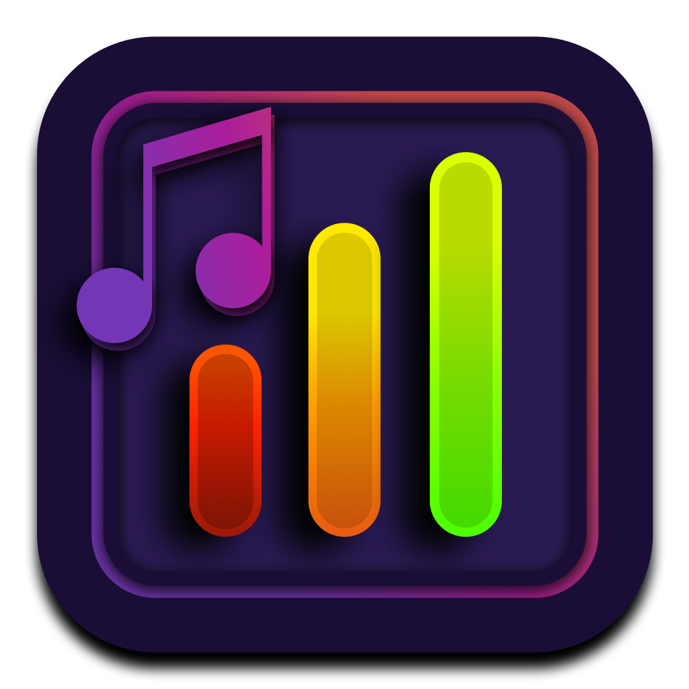
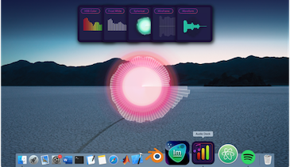
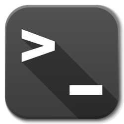

   
<b>Audio Dock</b>

### Features
- Supports 5 different visualization styles
- Transparent backgrounds allows visualization to seamlessly overlay
- Powered by P5.js
 

### Languages/Frameworks
&nbsp;&nbsp;&nbsp;&nbsp;&nbsp;&nbsp;&nbsp;&nbsp;&nbsp;&nbsp;&nbsp;&nbsp;&nbsp;&nbsp;&nbsp;&nbsp;&nbsp;&nbsp;&nbsp;&nbsp;&nbsp;&nbsp;&nbsp;&nbsp;&nbsp;

 

### Project Files 
[Audio Dock Source Files](https://github.com/MichaelTroeung/Audio-Dock/tree/main)&nbsp;&nbsp;&nbsp;&nbsp;&nbsp;&nbsp;&nbsp;&nbsp;&nbsp;&nbsp; [MacOS Build [dmg]](https://github.com/MichaelTroeung/Audio-Dock/releases/download/Release/Audio.Dock.app.zip)&nbsp;&nbsp;&nbsp;&nbsp;&nbsp;&nbsp;&nbsp;&nbsp;&nbsp;&nbsp;

MacOS [.dmg] installer available above. <b> NOTE: On MacOS right click and open to override warning. </b>

